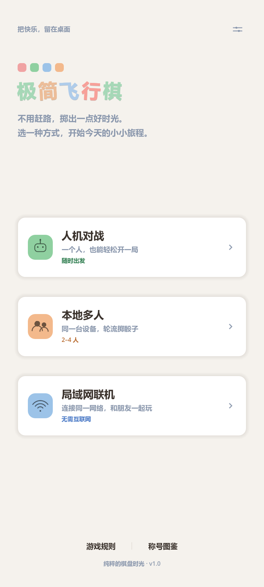
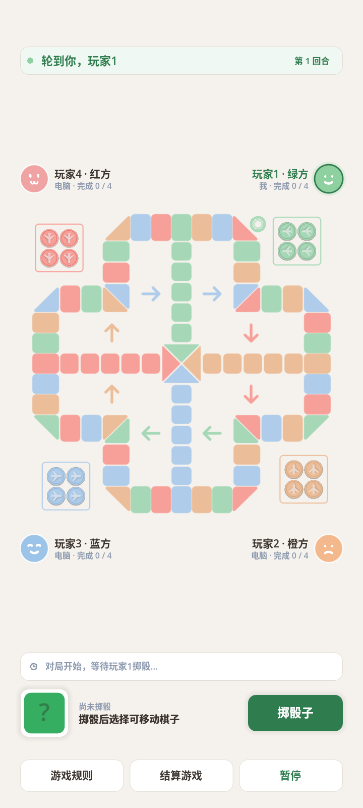
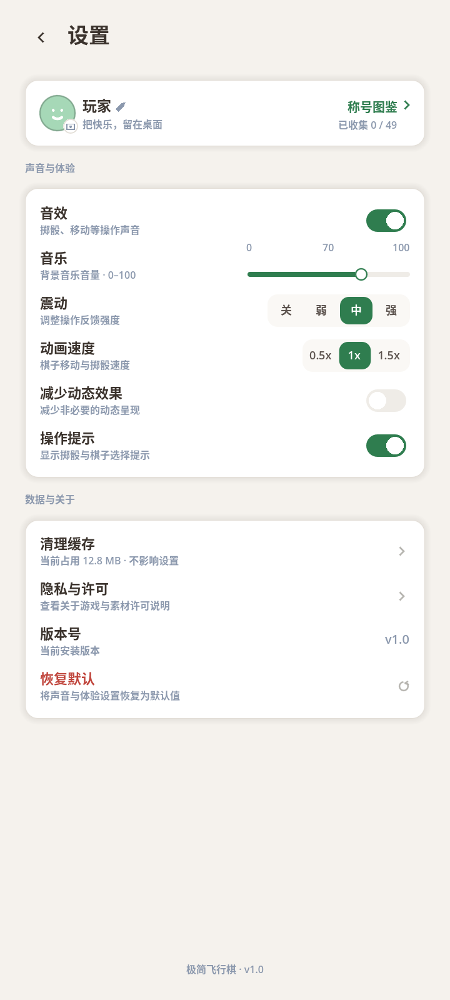
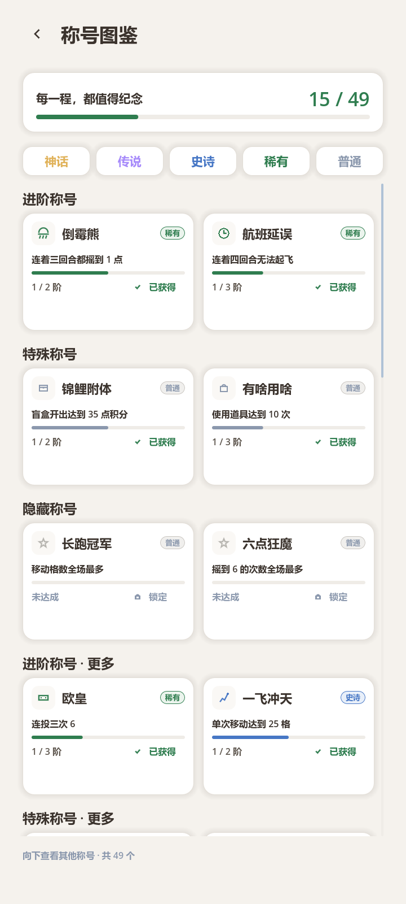

# 极简飞行棋 · Godot 重制版

> 英文项目名：**Paper Flight Chess**

  

  <b>一款用 Godot 4 重制的极简风格飞行棋，支持本地多人、人机对战和局域网联机。</b>

  <a href="https://github.com/lovexf/paper-flight-chess">GitHub</a>
  ·
  <a href="./LICENSE">AGPL-3.0</a>
  ·
  <a href="./NOTICE.md">第三方致谢</a>

---

## 项目简介

《极简飞行棋》是一个以暖纸色、白卡片和柔和玩家色为视觉语言的飞行棋游戏。规则引擎与棋盘坐标来源于 [ZTMYO/MinimalistAeroplaneChess](https://github.com/ZTMYO/MinimalistAeroplaneChess)，本仓库是它的 **Godot 4 重制版**，使用 GDScript 和自定义 draw UI 实现，主要面向 Android 手机，也可以在桌面端运行。

本项目按 **GNU Affero 通用公共许可证第 3 版（AGPL-3.0）** 开源。任何分发或通过网络提供修改版服务时，都需要按 AGPL-3.0 提供对应源代码。

## 功能

- **三种对局入口**：人机对战、本地多人（2–4 人）、局域网联机。
- **三种玩法**：经典、欢乐、道具；欢乐模式改变碰撞/叠子规则，道具模式用积分购买遥控骰子、多面骰子、传送门和盲盒。
- **局域网联机**：自动发现附近房间，也支持手动输入房主 IP；支持房主设置、座位/颜色、准备状态、断线恢复和房主离开提示。
- **称号图鉴**：局内实时称号与结算称号，按稀有度筛选，记录本机玩家获得的称号。
- **设置页**：音效/音乐/震动/动画速度/减少动态效果/操作提示，以及昵称和 20 款头像编辑。
- **完整规则书**：从胜利条件、起飞、移动、连投、跳跃、飞棋、叠子、撞机到道具/欢乐模式的完整说明。
- **高屏适配**：棋盘与玩家头像条带居中，底部 HUD、设置页、称号页、规则弹窗和联机页面按真实屏高重排；弹窗遮罩全屏。
- **纯本地数据**：没有账号系统、后端接口、统计上报或云存档。user:// 下只保存昵称、头像编号和本地设置。

## 界面预览

| 首页 | 对局 |
| --- | --- |
|  |  |

| 设置 | 称号图鉴 |
| --- | --- |
|  |  |

## 技术栈

- **引擎**：Godot 4.7（GL Compatibility）
- **语言**：GDScript
- **平台**：Android（固定竖屏，720×1280 设计基准，自适应高屏）；桌面端可用于开发调试
- **UI**：自定义 CanvasItem draw，不依赖第三方 UI 插件
- **网络**：Godot StreamPeerTCP / PacketPeerUDP，局域网直连

## 目录结构

    .
    ├── project.godot          # Godot 工程配置
    ├── scenes/                # Main.tscn、棋盘场景
    ├── scripts/               # GDScript 源码
    │   ├── achievements/      # 称号、统计、图鉴
    │   ├── core/              # 规则引擎、序列化、协议
    │   ├── game/              # 对局流程、AI、状态
    │   ├── net/               # 局域网发现、会话、协议
    │   ├── render/            # 棋盘/棋子绘制基础
    │   └── ui/                # 首页、设置、称号、HUD、联机 UI
    ├── assets/                # 棋盘、棋子、头像、道具图标、音效
    ├── data/                  # 棋盘坐标与规则文本
    ├── docs/screenshots/      # README 截图
    ├── LICENSE                # AGPL-3.0
    └── NOTICE.md              # 第三方来源与授权说明

> 仓库只保留运行所需的源码和资源；测试脚本、临时截图、构建产物、签名文件以及内部文档不纳入。

## 运行

1. 安装 **Godot 4.7**（建议 4.7.2）。
2. 用 Godot 打开 project.godot。
3. 运行主场景：scenes/Main.tscn。
4. 直接运行桌面窗口可以调试 UI；Android 真机推荐 720×1600 或更高分辨率。

也可以用命令行打开编辑器：

    godot --editor project.godot

## Android 构建

项目使用 Godot 的 Android 导出，不需要 Gradle 自定义构建。需要准备：

- Android SDK（Build Tools）
- JDK 17
- Godot 4.7 的 Android 导出模板
- 自己的 Android keystore（**不要提交到仓库**）

首次构建：

1. 复制示例导出配置：
       cp export_presets.example.cfg export_presets.cfg
2. 在 Godot 的 **项目 → 导出 → Android** 中配置 SDK 路径。
3. 在 export_presets.cfg 里填写自己的 keystore 路径、alias 和密码；或者直接在导出面板里选择 keystore。
4. 导出 debug 包：
       godot --headless --export-debug "Android" build/jjfxq-debug.apk
5. 导出 release 包：
       godot --headless --export-release "Android" build/jjfxq-release.apk

export_presets.cfg、*.keystore、*.jks、build/ 和 *.apk 已加入 .gitignore，请勿提交。

默认包名：com.xiaofeng.jjfxq；版本：1.0.0。如要发布到自己的应用商店，请修改包名和版本号。

## 局域网联机

- 服务端口：TCP 7788（连续尝试 7788–7791）
- 自动发现：UDP 7789
- 需要两台设备处于同一局域网；部分路由器会隔离客户端，此时请关闭 AP 隔离或使用手动 IP 连接。
- 房间号和本机 IP 只显示在当前房间页，不写盘、不上传。

## 数据与隐私

- 昵称：user://net_nickname.txt
- 头像编号：user://net_avatar.txt
- 设置：user://settings.json
- 称号记录：user://titles.json
- 不收集设备标识、不使用第三方统计、不请求外部服务器。
- 局域网 IP 仅用于当前房间展示和连接。

## 授权

本项目以 **AGPL-3.0** 发布，完整文本见 [LICENSE](./LICENSE)。简要说明：

- 自己玩、朋友间安装：无需额外操作；
- 分发安装包：需要同时提供完整源代码；
- 修改后分发：修改版仍需使用 AGPL-3.0 并提供源代码；
- 将修改版作为网络服务提供：需要向使用者提供对应源代码。

## 第三方来源与致谢

- **MinimalistAeroplaneChess** — 规则引擎、棋盘坐标与原始视觉资产的来源：
  <https://github.com/ZTMYO/MinimalistAeroplaneChess>
- **Godot Engine** — MIT License：<https://godotengine.org>
- 更多来源、移植说明和授权细节见 [NOTICE.md](./NOTICE.md)。

本项目是独立重制版，与上述项目的作者不存在隶属或背书关系；上游项目的版权归其作者所有。

## 参与贡献

欢迎提交 Issue 或 Pull Request。提交前请：

1. 不包含任何 keystore、密码、token、私有 IP、ADB 路径或个人目录；
2. 保持 AGPL-3.0 兼容；
3. 不改动 LICENSE / NOTICE.md 中的上游署名；
4. 说明复现步骤和测试设备/分辨率。

## 免责声明

本项目按“现状”提供，不附带任何明示或暗示的担保。使用、分发或运营修改版所产生的风险由使用者自行承担。
